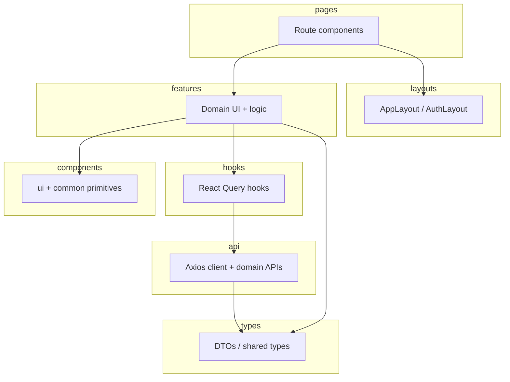

# Frontend Architecture

Smart Meal Planner web app — **architecture scaffold only**. Feature UI and API calls are not implemented yet.

## Layer diagram



## Directory layout

```
web/
├── public/                 # Static assets
├── src/
│   ├── main.tsx            # React entry
│   ├── App.tsx             # Router + QueryClientProvider
│   │
│   ├── api/                # HTTP layer (backend boundary)
│   │   ├── client.ts       # Axios instance, interceptors
│   │   ├── authApi.ts
│   │   ├── usersApi.ts
│   │   ├── recipesApi.ts
│   │   ├── mealPlansApi.ts
│   │   ├── pantryApi.ts
│   │   ├── groceryApi.ts
│   │   ├── todosApi.ts
│   │   └── inventoryAlertsApi.ts
│   │
│   ├── components/         # Shared, domain-agnostic UI
│   │   ├── ui/             # Design-system primitives
│   │   └── common/         # Loading, errors, empty states
│   │
│   ├── features/           # Vertical slices (one folder per domain)
│   │   ├── auth/
│   │   ├── profile/
│   │   ├── recipes/
│   │   ├── meal-planner/
│   │   ├── pantry/
│   │   ├── grocery/
│   │   ├── todos/
│   │   └── inventory-alerts/
│   │
│   ├── pages/              # Route targets (thin composition)
│   ├── hooks/              # Cross-cutting React hooks
│   ├── layouts/            # App chrome (nav, auth shell)
│   └── types/              # TypeScript types mirroring API DTOs
│
├── vite.config.ts
├── tsconfig.json
└── package.json
```

## Layer rules

| Layer | Responsibility | May import from |
|-------|----------------|-----------------|
| **pages** | Wire routes to feature UI; no API calls | layouts, features, components |
| **layouts** | Shell, nav, auth guards | components, hooks |
| **features** | Domain screens, forms, tables | api, hooks, types, components |
| **hooks** | React Query queries/mutations | api, types |
| **api** | HTTP functions only | types, client |
| **types** | Interfaces, enums | nothing in src |
| **components** | Reusable UI | types (props only) |

**Forbidden:** `features/A` importing `features/B` directly. Share via `components/`, `hooks/`, or `types/`.

## Data flow

1. **Page** renders a feature container (e.g. `RecipesPage` → `features/recipes/RecipeList`).
2. **Feature** uses **hooks** (`useRecipes`) backed by **React Query**.
3. **Hook** calls **api** module (`recipesApi.getAll()`).
4. **api** uses **client** (JWT header, error normalization).
5. Responses typed with **types** matching backend `ApiResult<T>`.

## Auth model

- JWT access token attached in `api/client.ts` interceptor.
- Refresh flow: `authApi.refresh` on 401 (to be implemented).
- `AuthLayout` for `/login`, `/register`; `AppLayout` for authenticated routes.
- Todos are **user-scoped**; all other modules are **household-scoped** via API.

## Routes (scaffold)

| Path | Page | Backend |
|------|------|---------|
| `/login` | LoginPage | POST /api/auth/login |
| `/register` | RegisterPage | POST /api/auth/register |
| `/dashboard` | DashboardPage | GET /api/dashboard (future) |
| `/profile` | ProfilePage | GET/PUT /api/users/me |
| `/recipes` | RecipesPage | /api/recipes |
| `/meal-planner` | MealPlannerPage | /api/meal-plans |
| `/pantry` | PantryPage | /api/pantry/items |
| `/grocery` | GroceryListPage | /api/grocery/lists |
| `/todos` | TodosPage | /api/todos |
| `/alerts` | AlertsPage | /api/inventory-alerts |

## Environment

| Variable | Purpose |
|----------|---------|
| `VITE_API_BASE_URL` | API origin (empty = same origin; dev uses Vite proxy) |

## Implementation order (suggested)

1. `api/client.ts` — JWT interceptors
2. `features/auth` + `hooks/useAuth` — login/register/session
3. `layouts/AppLayout` — navigation
4. Remaining features in PRD priority: recipes → meal planner → pantry → grocery → todos → alerts

## Related docs

- [system-design.md](/docs/system-design.md) — full-stack overview
- [product-requirements.md](/docs/product-requirements.md) — feature specs
