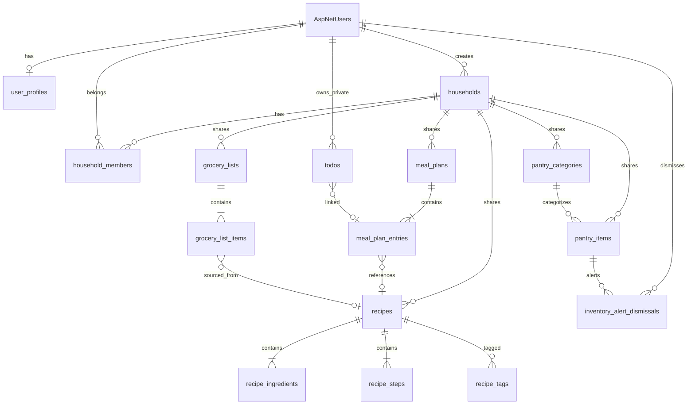

# Smart Meal Planner — Database Design

**Version:** 1.2 (MVP)  
**Database:** PostgreSQL 16  
**ORM:** Entity Framework Core 8 (Code-First)  
**Last Updated:** June 2026

---

## 1. Design Principles

| Principle | Implementation |
|-----------|----------------|
| Primary keys | `UUID` (`uuid` type, `gen_random_uuid()` default) |
| Household-shared data | `household_id` NOT NULL on recipes, meal_plans, pantry, grocery; access via `household_members` |
| User-private data | `user_id` NOT NULL on todos and profile prefs; no `household_id` on todos |
| Audit trail | `created_by_user_id` on household-shared tables (who created; not access control) |
| Auditing | `created_at`, `updated_at` TIMESTAMPTZ on all tables |
| Soft delete | `is_deleted`, `deleted_at` on recipes and todos |
| Naming | snake_case table/column names (EF Core naming convention) |
| Timestamps | UTC storage; display in user timezone via application layer |
| Auth | ASP.NET Identity standard tables with `uuid` user id |

---

## 2. Entity-Relationship Diagram



---

## 3. Module Overview

| Module | Tables |
|--------|--------|
| Auth | `AspNetUsers`, `AspNetRoles`, `AspNetUserRoles`, `AspNetUserClaims`, `AspNetUserLogins`, `AspNetUserTokens`, `AspNetRoleClaims` |
| Users | `user_profiles`, `households`, `household_members` (active in MVP) |
| Recipes | `recipes`, `recipe_ingredients`, `recipe_steps`, `recipe_tags` |
| Meal Planner | `meal_plans`, `meal_plan_entries` |
| Pantry | `pantry_categories`, `pantry_items` |
| Grocery | `grocery_lists`, `grocery_list_items` |
| Todo | `todos` |
| Inventory Alerts | `inventory_alert_dismissals` (alerts computed at read time) |

---

## 4. Auth Module (ASP.NET Identity)

ASP.NET Identity generates standard tables. `AspNetUsers` is extended via `ApplicationUser` and linked to `user_profiles`.

### 4.1 AspNetUsers (extended)

| Column | Type | Constraints | Description |
|--------|------|-------------|-------------|
| id | UUID | PK | User identifier |
| user_name | VARCHAR(256) | UNIQUE, NOT NULL | Login username (email) |
| normalized_user_name | VARCHAR(256) | UNIQUE, NOT NULL | Uppercase username |
| email | VARCHAR(256) | UNIQUE, NOT NULL | Email address |
| normalized_email | VARCHAR(256) | UNIQUE, NOT NULL | Uppercase email |
| email_confirmed | BOOLEAN | NOT NULL, DEFAULT false | Email verified flag |
| password_hash | TEXT | NULL | Hashed password |
| security_stamp | TEXT | NULL | Identity security stamp |
| concurrency_stamp | TEXT | NULL | Optimistic concurrency |
| phone_number | VARCHAR(50) | NULL | Optional phone |
| phone_number_confirmed | BOOLEAN | NOT NULL, DEFAULT false | |
| two_factor_enabled | BOOLEAN | NOT NULL, DEFAULT false | |
| lockout_end | TIMESTAMPTZ | NULL | Lockout expiry |
| lockout_enabled | BOOLEAN | NOT NULL, DEFAULT true | |
| access_failed_count | INTEGER | NOT NULL, DEFAULT 0 | |
| created_at | TIMESTAMPTZ | NOT NULL, DEFAULT now() | Custom audit field |
| updated_at | TIMESTAMPTZ | NOT NULL, DEFAULT now() | Custom audit field |

**Indexes:**

- PK: `id`
- UNIQUE: `normalized_user_name`, `normalized_email`

### 4.2 AspNetRoles

| Column | Type | Constraints |
|--------|------|-------------|
| id | UUID | PK |
| name | VARCHAR(256) | NOT NULL |
| normalized_name | VARCHAR(256) | UNIQUE, NOT NULL |
| concurrency_stamp | TEXT | NULL |

**Seed data:** `User`, `Admin` (MVP assigns `User` on registration).

### 4.3 AspNetUserRoles

| Column | Type | Constraints |
|--------|------|-------------|
| user_id | UUID | PK, FK → AspNetUsers.id |
| role_id | UUID | PK, FK → AspNetRoles.id |

### 4.4 AspNetUserClaims / AspNetUserLogins / AspNetUserTokens / AspNetRoleClaims

Standard Identity schema per EF Core Identity migration. No custom columns in MVP.

---

## 5. Users Module

### 5.1 user_profiles

Extended profile and preferences. One-to-one with `AspNetUsers`.

| Column | Type | Constraints | Description |
|--------|------|-------------|-------------|
| id | UUID | PK, DEFAULT gen_random_uuid() | Profile id |
| user_id | UUID | UNIQUE, NOT NULL, FK → AspNetUsers.id ON DELETE CASCADE | Owner |
| display_name | VARCHAR(100) | NOT NULL | Display name |
| avatar_url | VARCHAR(500) | NULL | Optional avatar URL |
| dietary_preferences | TEXT[] | NULL | Array of preference tags |
| default_servings | INTEGER | NOT NULL, DEFAULT 4, CHECK (1-20) | Default recipe servings |
| timezone | VARCHAR(50) | NOT NULL, DEFAULT 'UTC' | IANA timezone |
| household_id | UUID | NOT NULL, FK → households.id ON DELETE RESTRICT | Active household |
| created_at | TIMESTAMPTZ | NOT NULL, DEFAULT now() | |
| updated_at | TIMESTAMPTZ | NOT NULL, DEFAULT now() | |

**Indexes:**

- PK: `id`
- UNIQUE: `user_id`
- INDEX: `household_id` (partial, WHERE household_id IS NOT NULL)

### 5.2 households

| Column | Type | Constraints | Description |
|--------|------|-------------|-------------|
| id | UUID | PK, DEFAULT gen_random_uuid() | Household id |
| name | VARCHAR(100) | NOT NULL | Household name (e.g. "Dhana Family") |
| created_by_user_id | UUID | NOT NULL, FK → AspNetUsers.id ON DELETE RESTRICT | Creator |
| created_at | TIMESTAMPTZ | NOT NULL, DEFAULT now() | |
| updated_at | TIMESTAMPTZ | NOT NULL, DEFAULT now() | |

**MVP:** Auto-created on user registration with default name "{DisplayName}'s Family".

**Indexes:**

- PK: `id`
- INDEX: `created_by_user_id`

### 5.3 household_members

| Column | Type | Constraints | Description |
|--------|------|-------------|-------------|
| id | UUID | PK, DEFAULT gen_random_uuid() | Membership id |
| household_id | UUID | NOT NULL, FK → households.id ON DELETE CASCADE | |
| user_id | UUID | NOT NULL, FK → AspNetUsers.id ON DELETE CASCADE | |
| role | VARCHAR(20) | NOT NULL, DEFAULT 'member' | owner, member (registration creates owner) |
| display_label | VARCHAR(50) | NULL | e.g. "Mom", "Dad", "Child" |
| joined_at | TIMESTAMPTZ | NOT NULL, DEFAULT now() | |
| created_at | TIMESTAMPTZ | NOT NULL, DEFAULT now() | |
| updated_at | TIMESTAMPTZ | NOT NULL, DEFAULT now() | |

**CHECK constraint:** `role IN ('owner', 'member')`

**MVP:** Multi-member households supported. Registration creates one Owner. Additional members added via Owner API or dev seed (see [`docs/dev-seed.md`](dev-seed.md)). Exactly one Owner per household.

**Indexes:**

- PK: `id`
- UNIQUE: `(household_id, user_id)`
- UNIQUE: `(household_id) WHERE role = 'owner'` — one Owner per household (partial unique index)
- INDEX: `user_id`

---

## 6. Recipes Module

### 6.1 recipes

**Scope:** Household-shared. All members of the household see the same recipe library.

| Column | Type | Constraints | Description |
|--------|------|-------------|-------------|
| id | UUID | PK, DEFAULT gen_random_uuid() | Recipe id |
| household_id | UUID | NOT NULL, FK → households.id ON DELETE CASCADE | Access boundary |
| created_by_user_id | UUID | NOT NULL, FK → AspNetUsers.id ON DELETE RESTRICT | Audit: who added |
| title | VARCHAR(200) | NOT NULL | Recipe title |
| description | TEXT | NULL | Optional description |
| servings | INTEGER | NOT NULL, DEFAULT 4, CHECK (1-50) | Number of servings |
| prep_time_minutes | INTEGER | NULL, CHECK (0-1440) | Prep time |
| cook_time_minutes | INTEGER | NULL, CHECK (0-1440) | Cook time |
| is_deleted | BOOLEAN | NOT NULL, DEFAULT false | Soft delete flag |
| deleted_at | TIMESTAMPTZ | NULL | Soft delete timestamp |
| created_at | TIMESTAMPTZ | NOT NULL, DEFAULT now() | |
| updated_at | TIMESTAMPTZ | NOT NULL, DEFAULT now() | |

**Indexes:**

- PK: `id`
- INDEX: `(household_id, is_deleted)` — list active recipes
- INDEX: `(household_id, title)` — search by title
- INDEX: `created_by_user_id`

### 6.2 recipe_ingredients

| Column | Type | Constraints | Description |
|--------|------|-------------|-------------|
| id | UUID | PK, DEFAULT gen_random_uuid() | Ingredient row id |
| recipe_id | UUID | NOT NULL, FK → recipes.id ON DELETE CASCADE | Parent recipe |
| name | VARCHAR(200) | NOT NULL | Ingredient name |
| quantity | DECIMAL(10,2) | NOT NULL, CHECK (quantity >= 0) | Amount |
| unit | VARCHAR(50) | NOT NULL | Unit of measure |
| sort_order | INTEGER | NOT NULL, DEFAULT 0 | Display order |
| created_at | TIMESTAMPTZ | NOT NULL, DEFAULT now() | |
| updated_at | TIMESTAMPTZ | NOT NULL, DEFAULT now() | |

**Indexes:**

- PK: `id`
- INDEX: `recipe_id`
- INDEX: `(recipe_id, sort_order)`

### 6.3 recipe_steps

| Column | Type | Constraints | Description |
|--------|------|-------------|-------------|
| id | UUID | PK, DEFAULT gen_random_uuid() | Step id |
| recipe_id | UUID | NOT NULL, FK → recipes.id ON DELETE CASCADE | Parent recipe |
| step_number | INTEGER | NOT NULL, CHECK (step_number >= 1) | Order |
| instruction | TEXT | NOT NULL | Step text |
| created_at | TIMESTAMPTZ | NOT NULL, DEFAULT now() | |
| updated_at | TIMESTAMPTZ | NOT NULL, DEFAULT now() | |

**Indexes:**

- PK: `id`
- UNIQUE: `(recipe_id, step_number)`
- INDEX: `recipe_id`

### 6.4 recipe_tags

| Column | Type | Constraints | Description |
|--------|------|-------------|-------------|
| id | UUID | PK, DEFAULT gen_random_uuid() | Tag row id |
| recipe_id | UUID | NOT NULL, FK → recipes.id ON DELETE CASCADE | Parent recipe |
| tag | VARCHAR(50) | NOT NULL | Tag value |
| created_at | TIMESTAMPTZ | NOT NULL, DEFAULT now() | |

**Indexes:**

- PK: `id`
- INDEX: `recipe_id`
- INDEX: `(recipe_id, tag)`
- INDEX: `tag` — filter recipes by tag (join with recipes.household_id)

---

## 7. Meal Planner Module

### 7.1 meal_plans

One plan per household per week (Monday start date). **Household-shared.**

| Column | Type | Constraints | Description |
|--------|------|-------------|-------------|
| id | UUID | PK, DEFAULT gen_random_uuid() | Plan id |
| household_id | UUID | NOT NULL, FK → households.id ON DELETE CASCADE | Access boundary |
| created_by_user_id | UUID | NOT NULL, FK → AspNetUsers.id ON DELETE RESTRICT | Audit: who created |
| week_start_date | DATE | NOT NULL | Monday of the week |
| created_at | TIMESTAMPTZ | NOT NULL, DEFAULT now() | |
| updated_at | TIMESTAMPTZ | NOT NULL, DEFAULT now() | |

**Indexes:**

- PK: `id`
- UNIQUE: `(household_id, week_start_date)`
- INDEX: `(household_id, week_start_date DESC)`

### 7.2 meal_plan_entries

| Column | Type | Constraints | Description |
|--------|------|-------------|-------------|
| id | UUID | PK, DEFAULT gen_random_uuid() | Entry id |
| meal_plan_id | UUID | NOT NULL, FK → meal_plans.id ON DELETE CASCADE | Parent plan |
| recipe_id | UUID | NULL, FK → recipes.id ON DELETE SET NULL | Assigned recipe |
| entry_date | DATE | NOT NULL | Day within the week |
| meal_slot | VARCHAR(20) | NOT NULL | Breakfast, Lunch, Dinner, Snack |
| note | VARCHAR(500) | NULL | Optional note |
| sort_order | INTEGER | NOT NULL, DEFAULT 0 | Order within slot |
| created_at | TIMESTAMPTZ | NOT NULL, DEFAULT now() | |
| updated_at | TIMESTAMPTZ | NOT NULL, DEFAULT now() | |

**CHECK constraint:** `meal_slot IN ('Breakfast', 'Lunch', 'Dinner', 'Snack')`

**Indexes:**

- PK: `id`
- INDEX: `meal_plan_id`
- INDEX: `(meal_plan_id, entry_date, meal_slot)` — weekly view query
- INDEX: `recipe_id`
- INDEX: `(entry_date, meal_slot)` — dashboard today query (via join)

---

## 8. Pantry Module

### 8.1 pantry_categories

**Scope:** Household-shared custom categories; system defaults are global (`household_id` NULL).

| Column | Type | Constraints | Description |
|--------|------|-------------|-------------|
| id | UUID | PK, DEFAULT gen_random_uuid() | Category id |
| household_id | UUID | NULL, FK → households.id ON DELETE CASCADE | NULL = system default |
| created_by_user_id | UUID | NULL, FK → AspNetUsers.id ON DELETE SET NULL | Audit for custom categories |
| name | VARCHAR(100) | NOT NULL | Category name |
| is_system | BOOLEAN | NOT NULL, DEFAULT false | System-seeded category |
| sort_order | INTEGER | NOT NULL, DEFAULT 0 | Display order |
| created_at | TIMESTAMPTZ | NOT NULL, DEFAULT now() | |
| updated_at | TIMESTAMPTZ | NOT NULL, DEFAULT now() | |

**Indexes:**

- PK: `id`
- INDEX: `(household_id, is_system)`
- UNIQUE: `(household_id, name)` WHERE household_id IS NOT NULL

**Seed data (is_system = true, household_id = NULL):**

- Produce, Dairy, Meat, Pantry Staples, Frozen, Beverages, Other

### 8.2 pantry_items

**Scope:** Household-shared. All members see and update the same pantry.

| Column | Type | Constraints | Description |
|--------|------|-------------|-------------|
| id | UUID | PK, DEFAULT gen_random_uuid() | Item id |
| household_id | UUID | NOT NULL, FK → households.id ON DELETE CASCADE | Access boundary |
| created_by_user_id | UUID | NOT NULL, FK → AspNetUsers.id ON DELETE RESTRICT | Audit: who added |
| category_id | UUID | NULL, FK → pantry_categories.id ON DELETE SET NULL | Category |
| name | VARCHAR(200) | NOT NULL | Item name |
| quantity | DECIMAL(10,2) | NOT NULL, DEFAULT 0, CHECK (quantity >= 0) | Current quantity |
| unit | VARCHAR(50) | NOT NULL | Unit of measure |
| low_stock_threshold | DECIMAL(10,2) | NULL, CHECK (low_stock_threshold >= 0) | Alert threshold |
| expiry_date | DATE | NULL | Optional expiry |
| notes | VARCHAR(500) | NULL | Optional notes |
| created_at | TIMESTAMPTZ | NOT NULL, DEFAULT now() | |
| updated_at | TIMESTAMPTZ | NOT NULL, DEFAULT now() | |

**Indexes:**

- PK: `id`
- INDEX: `(household_id, name)` — search
- INDEX: `(household_id, category_id)` — filter by category
- INDEX: `(household_id, expiry_date)` WHERE expiry_date IS NOT NULL — expiring alerts
- INDEX: `(household_id, quantity, low_stock_threshold)` WHERE low_stock_threshold IS NOT NULL — low stock queries

---

## 9. Grocery Module

### 9.1 grocery_lists

**Scope:** Household-shared.

| Column | Type | Constraints | Description |
|--------|------|-------------|-------------|
| id | UUID | PK, DEFAULT gen_random_uuid() | List id |
| household_id | UUID | NOT NULL, FK → households.id ON DELETE CASCADE | Access boundary |
| created_by_user_id | UUID | NOT NULL, FK → AspNetUsers.id ON DELETE RESTRICT | Audit: who created |
| name | VARCHAR(200) | NOT NULL | List name |
| meal_plan_id | UUID | NULL, FK → meal_plans.id ON DELETE SET NULL | Source meal plan if generated |
| is_archived | BOOLEAN | NOT NULL, DEFAULT false | Archived list |
| created_at | TIMESTAMPTZ | NOT NULL, DEFAULT now() | |
| updated_at | TIMESTAMPTZ | NOT NULL, DEFAULT now() | |

**Indexes:**

- PK: `id`
- INDEX: `(household_id, is_archived, created_at DESC)`
- INDEX: `meal_plan_id`

### 9.2 grocery_list_items

| Column | Type | Constraints | Description |
|--------|------|-------------|-------------|
| id | UUID | PK, DEFAULT gen_random_uuid() | Item id |
| grocery_list_id | UUID | NOT NULL, FK → grocery_lists.id ON DELETE CASCADE | Parent list |
| name | VARCHAR(200) | NOT NULL | Item name |
| quantity | DECIMAL(10,2) | NOT NULL, DEFAULT 1, CHECK (quantity > 0) | Amount needed |
| unit | VARCHAR(50) | NOT NULL | Unit |
| is_checked | BOOLEAN | NOT NULL, DEFAULT false | Purchased flag |
| source_recipe_id | UUID | NULL, FK → recipes.id ON DELETE SET NULL | Traceability |
| note | VARCHAR(500) | NULL | Optional note |
| sort_order | INTEGER | NOT NULL, DEFAULT 0 | Display order |
| created_at | TIMESTAMPTZ | NOT NULL, DEFAULT now() | |
| updated_at | TIMESTAMPTZ | NOT NULL, DEFAULT now() | |

**Indexes:**

- PK: `id`
- INDEX: `grocery_list_id`
- INDEX: `(grocery_list_id, is_checked)`
- INDEX: `source_recipe_id`

---

## 10. Todo Module

### 10.1 todos

**Scope:** User-private. No `household_id` — each user manages only their own tasks.

| Column | Type | Constraints | Description |
|--------|------|-------------|-------------|
| id | UUID | PK, DEFAULT gen_random_uuid() | Todo id |
| user_id | UUID | NOT NULL, FK → AspNetUsers.id ON DELETE CASCADE | Access boundary (private) |
| title | VARCHAR(300) | NOT NULL | Todo title |
| description | TEXT | NULL | Optional details |
| status | VARCHAR(20) | NOT NULL, DEFAULT 'Pending' | Pending, Completed |
| due_date | DATE | NULL | Optional due date |
| completed_at | TIMESTAMPTZ | NULL | Completion timestamp |
| meal_plan_entry_id | UUID | NULL, FK → meal_plan_entries.id ON DELETE SET NULL | Optional link to shared meal |
| priority | INTEGER | NULL, DEFAULT 0 | Reserved for future (0=normal) |
| is_deleted | BOOLEAN | NOT NULL, DEFAULT false | Soft delete |
| deleted_at | TIMESTAMPTZ | NULL | Soft delete timestamp |
| created_at | TIMESTAMPTZ | NOT NULL, DEFAULT now() | |
| updated_at | TIMESTAMPTZ | NOT NULL, DEFAULT now() | |

**CHECK constraint:** `status IN ('Pending', 'Completed')`

**Indexes:**

- PK: `id`
- INDEX: `(user_id, status, is_deleted)` — active todos
- INDEX: `(user_id, due_date)` WHERE due_date IS NOT NULL AND is_deleted = false
- INDEX: `meal_plan_entry_id`

---

## 11. Inventory Alerts Module

Alerts are **computed at read time** from `pantry_items` data. Dismissals are persisted to avoid repeat display until condition changes.

### 11.1 inventory_alert_dismissals

| Column | Type | Constraints | Description |
|--------|------|-------------|-------------|
| id | UUID | PK, DEFAULT gen_random_uuid() | Dismissal id |
| user_id | UUID | NOT NULL, FK → AspNetUsers.id ON DELETE CASCADE | Who dismissed |
| pantry_item_id | UUID | NOT NULL, FK → pantry_items.id ON DELETE CASCADE | Related item |
| alert_type | VARCHAR(20) | NOT NULL | low_stock, expiring, expired |
| dismissed_at | TIMESTAMPTZ | NOT NULL, DEFAULT now() | When dismissed |
| condition_snapshot | VARCHAR(100) | NULL | e.g. qty=2/threshold=5 for re-trigger logic |
| created_at | TIMESTAMPTZ | NOT NULL, DEFAULT now() | |

**CHECK constraint:** `alert_type IN ('low_stock', 'expiring', 'expired')`

**Indexes:**

- PK: `id`
- UNIQUE: `(user_id, pantry_item_id, alert_type)` — one active dismissal per type per item
- INDEX: `(user_id, dismissed_at DESC)`

### 11.2 Alert Computation Rules (application layer)

| Alert Type | Condition | Severity |
|------------|-----------|----------|
| `low_stock` | `low_stock_threshold IS NOT NULL AND quantity <= low_stock_threshold` | Medium |
| `expiring` | `expiry_date IS NOT NULL AND expiry_date BETWEEN today AND today + 3 days` | Medium |
| `expired` | `expiry_date IS NOT NULL AND expiry_date < today` | High |

Re-trigger: if `condition_snapshot` differs from current state (e.g., quantity changed after restock), alert reappears even if previously dismissed.

---

## 12. Relationship Summary

| Parent | Child | Relationship | ON DELETE |
|--------|-------|--------------|-----------|
| AspNetUsers | user_profiles | 1:1 | CASCADE |
| households | household_members | 1:N | CASCADE |
| households | recipes | 1:N | CASCADE |
| households | meal_plans | 1:N | CASCADE |
| households | pantry_items | 1:N | CASCADE |
| households | grocery_lists | 1:N | CASCADE |
| AspNetUsers | todos | 1:N | CASCADE |
| recipes | recipe_ingredients | 1:N | CASCADE |
| recipes | recipe_steps | 1:N | CASCADE |
| recipes | recipe_tags | 1:N | CASCADE |
| meal_plans | meal_plan_entries | 1:N | CASCADE |
| meal_plan_entries | recipes | N:1 | SET NULL |
| grocery_lists | grocery_list_items | 1:N | CASCADE |
| pantry_categories | pantry_items | 1:N | SET NULL |
| households | user_profiles | 1:N | SET NULL |
| households | household_members | 1:N | CASCADE |
| pantry_items | inventory_alert_dismissals | 1:N | CASCADE |

---

## 13. Index Strategy Summary

| Query Pattern | Index |
|---------------|-------|
| Household's active recipes | `(household_id, is_deleted)` on recipes |
| Recipe detail with children | `recipe_id` on ingredients, steps, tags |
| Weekly meal plan | `(household_id, week_start_date)` UNIQUE on meal_plans |
| Day/slot entries | `(meal_plan_id, entry_date, meal_slot)` on meal_plan_entries |
| Pantry search | `(household_id, name)` on pantry_items |
| Low stock scan | `(household_id, quantity, low_stock_threshold)` partial on pantry_items |
| Expiring items | `(household_id, expiry_date)` partial on pantry_items |
| Active grocery list | `(household_id, is_archived, created_at DESC)` on grocery_lists |
| User's pending todos | `(user_id, status, is_deleted)` on todos |
| Dashboard today meals | Join meal_plans → meal_plan_entries on `entry_date` filtered by `household_id` |
| Alert dismissals | `(user_id, pantry_item_id, alert_type)` UNIQUE |
| Household membership lookup | `user_id` on household_members |
| One Owner per household | `(household_id) WHERE role = 'owner'` UNIQUE on household_members |

---

## 14. Seed Data

### 14.1 Roles (AspNetRoles)

| name | normalized_name |
|------|-----------------|
| User | USER |
| Admin | ADMIN |

### 14.2 Pantry Categories (system defaults)

| name | sort_order |
|------|------------|
| Produce | 1 |
| Dairy | 2 |
| Meat | 3 |
| Pantry Staples | 4 |
| Frozen | 5 |
| Beverages | 6 |
| Other | 99 |

Seeded via EF Core `HasData` or migration SQL with fixed UUIDs.

### 14.3 Dhana Family Dev Seed (reference)

Used by `dotnet run --seed` for local multi-member testing. See [`docs/dev-seed.md`](dev-seed.md) for full script.

| Entity | Key values |
|--------|------------|
| household | name = "Dhana Family", created_by = Dad user id |
| household_members | Dad (owner), Mom, Kid 1, Kid 2 (member) |
| users | dad@dhana.test, mom@dhana.test, kid1@dhana.test, kid2@dhana.test |
| recipes | 1 shared recipe ("Spaghetti Bolognese") with ingredients/steps |
| pantry_items | 2–3 sample items (e.g. pasta, ground beef) |
| meal_plans | Current week with 1 dinner entry |

---

## 15. Migration Strategy

1. **Initial migration** — Identity tables + all domain tables
2. **Seed migration** — roles, system pantry categories
3. **Per-module migrations** — additive only during MVP (no destructive changes without backup)
4. **Naming** — `{timestamp}_{Description}` (EF Core default)
5. **Environments** — `dotnet ef database update` in CI/CD for staging/prod; auto-run on dev startup optional

### EF Core Configuration Notes

- Use `IEntityTypeConfiguration<T>` per entity in `Infrastructure/Persistence/Configurations/`
- Global query filter for soft delete: `modelBuilder.Entity<Recipe>().HasQueryFilter(r => !r.IsDeleted)`
- Apply same filter for `Todo`
- `UpdatedAt` set via `SaveChanges` override or interceptor

---

## 16. Sample Queries

### 16.1 Dashboard — Today's Meals

```sql
SELECT mpe.id, mpe.meal_slot, mpe.note, r.title AS recipe_title
FROM meal_plan_entries mpe
JOIN meal_plans mp ON mp.id = mpe.meal_plan_id
LEFT JOIN recipes r ON r.id = mpe.recipe_id AND r.is_deleted = false
WHERE mp.household_id = @householdId
  AND mpe.entry_date = @today
ORDER BY mpe.meal_slot, mpe.sort_order;
```

### 16.2 Low Stock Alerts

```sql
SELECT pi.id, pi.name, pi.quantity, pi.unit, pi.low_stock_threshold
FROM pantry_items pi
LEFT JOIN inventory_alert_dismissals iad
  ON iad.pantry_item_id = pi.id
  AND iad.user_id = pi.user_id
  AND iad.alert_type = 'low_stock'
  AND iad.condition_snapshot = CONCAT(pi.quantity, '/', pi.low_stock_threshold)
WHERE pi.household_id = @householdId
  AND pi.low_stock_threshold IS NOT NULL
  AND pi.quantity <= pi.low_stock_threshold
  AND iad.id IS NULL;
```

### 16.3 Grocery List Generation (ingredient aggregation)

```sql
SELECT ri.name, ri.unit, SUM(ri.quantity * (mpe.servings_override / r.servings)) AS total_quantity
FROM meal_plan_entries mpe
JOIN recipes r ON r.id = mpe.recipe_id
JOIN recipe_ingredients ri ON ri.recipe_id = r.id
JOIN meal_plans mp ON mp.id = mpe.meal_plan_id
WHERE mp.id = @mealPlanId
  AND r.is_deleted = false
GROUP BY LOWER(ri.name), ri.unit
ORDER BY ri.name;
```

Note: MVP uses recipe default servings; `servings_override` on meal_plan_entries is a future column if needed.

---

## 17. Data Ownership Reference

### Household-shared tables (`household_id` NOT NULL)

| Table | Shared data | Notes |
|-------|-------------|-------|
| recipes | Family recipe book | `created_by_user_id` for audit |
| meal_plans | Weekly meal plan | One plan per household per week |
| meal_plan_entries | Daily meal slots | Inherits household via meal_plan |
| pantry_items | Family pantry / inventory | All members read/write |
| pantry_categories | Custom categories | System defaults have `household_id` NULL |
| grocery_lists | Shopping lists | All members read/write |
| grocery_list_items | List line items | Inherits household via grocery_list |

**Authorization:** `WHERE household_id = @currentUserHouseholdId` after verifying `household_members`.

### User-private tables (`user_id` only, no `household_id`)

| Table | Private data | Notes |
|-------|--------------|-------|
| user_profiles | Display name, prefs, timezone | `household_id` links user to family but prefs are not shared |
| todos | Personal tasks | Alice's todos are invisible to Bob |
| inventory_alert_dismissals | Per-user dismiss state | Shared alerts; personal dismiss |

**Authorization:** `WHERE user_id = @currentUserId`.

### Membership

| Table | Purpose |
|-------|---------|
| households | Family group ("Dhana Family") |
| household_members | Links users to household with role (owner/member) and label (Mom, Dad, Child) |

On registration: create `household` → create `household_member` (role = `owner`) → set `user_profiles.household_id`.

---

## 18. Storage Estimates (MVP)

| Entity | Est. rows/user/year | Notes |
|--------|---------------------|-------|
| recipes | 50–200 | Active library |
| recipe_ingredients | 500–2000 | ~10 per recipe |
| meal_plan_entries | 500–1500 | ~3/day × 365 |
| pantry_items | 50–150 | Typical pantry |
| grocery_list_items | 1000–3000 | Weekly shops |
| todos | 200–500 | Daily tasks |

PostgreSQL Burstable B1ms (32 GB storage) is sufficient for thousands of users in MVP.

---

## 19. Document History

| Version | Date | Changes |
|---------|------|---------|
| 1.0 | June 2026 | Initial database design for MVP |
| 1.1 | June 2026 | Hybrid ownership: household_id on shared tables; todos user-private only |
| 1.2 | June 2026 | Owner/Member roles; one-owner partial unique index; Dhana Family seed reference |
