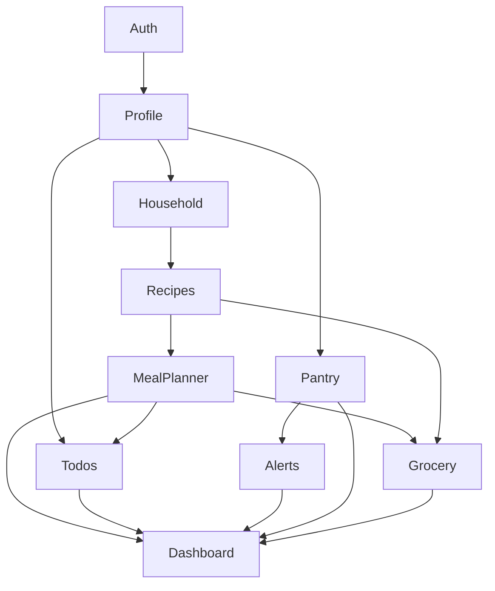

# Smart Meal Planner — Product Requirements Document (PRD)

**Version:** 1.2 (MVP)  
**Last Updated:** June 2026  
**Status:** Draft for implementation

---

## 1. Product Vision

Smart Meal Planner is a production-grade SaaS web application that helps families, individuals, and home cooks plan meals, manage recipes, track pantry inventory, and coordinate daily kitchen tasks in one simple, reliable place.

The MVP prioritizes **real daily usage** over advanced automation. It must be clean, maintainable, debuggable, and extensible for a future mobile app and household sharing.

---

## 2. Target Users

| Persona | Description | Primary Needs |
|---------|-------------|---------------|
| **Family planner** | Parent or caregiver managing meals for a household | Weekly meal planning, grocery lists, pantry awareness |
| **Individual home cook** | Single person cooking at home | Recipe collection, simple weekly plan, todo reminders |
| **Busy professional** | Limited time, wants structure | Quick dashboard, grocery list from meal plan, low-friction todos |

---

## 3. MVP Scope

### In Scope

1. Authentication (register, login, logout, JWT sessions)
2. User Profile
3. Household Management (member list, Owner-only membership ops)
4. Recipes (CRUD, ingredients, steps)
5. Meal Planner (weekly view)
6. Pantry / Inventory Management
7. Grocery Lists
8. Todo Management
9. Inventory Alerts
10. Dashboard (aggregated overview)

### Out of Scope (MVP)

- AI meal suggestions or recipe generation
- Push notifications / email alerts
- Microservices, event buses, Redis, Kafka, message queues
- Household member invites (join codes, email invites) — additional members added via Owner API or dev/admin seed only
- Mobile native apps (design for future API compatibility only)
- Social features, recipe sharing marketplace
- Payment / subscriptions
- Admin panel (roles reserved for future)

### Data Ownership Model (MVP)

The app uses a **hybrid ownership model**: some data is shared at the **household (family) level**, and some remains **private per user**.

| Scope | Modules | Access rule |
|-------|---------|-------------|
| **Household-shared** | Recipes, Meal Planner, Pantry / Inventory, Grocery Lists, Inventory Alerts | All members of the same household see and edit the same data |
| **User-private** | User Profile, Todos | Each user sees and manages only their own data |

**Household setup (MVP):**

- On registration, the system auto-creates a household (e.g. "Alice's Family") and adds the user as **Owner** (`household_members.role = owner`).
- A user belongs to exactly one household in MVP.
- Households support **multiple members** from the start; additional members are added via Owner API or dev/admin seed (no self-serve invite flow).
- Each household has exactly one Owner; all other members have role `member`.
- Shared resources are keyed by `household_id`; `created_by_user_id` records who added an item (audit only, not access control).
- Todos are keyed by `user_id` only — family members do not see each other's personal tasks.
- All users log in individually and see the same household-shared data; optional personal views (e.g. "My tasks") are UI filters only.

**Example — Dhana Family:**

```
Household: "Dhana Family"
Members:
  - Dad (Owner)
  - Mom (Member)
  - Kid 1 (Member)
  - Kid 2 (Member)

Shared (all 4 see the same):
  - Recipes, Meal Plan, Pantry, Grocery List, Inventory Alerts

Private (each user sees only their own):
  - Todos (Dad's prep tasks ≠ Mom's tasks)
  - Profile preferences (display name, timezone, dietary prefs)
```

**Member provisioning (MVP, no invites):**

1. **Owner API** — Owner adds an already-registered user by email (`POST /api/households/me/members`).
2. **Dev/admin seed** — `dotnet run --seed` creates Dhana Family with 4 users for local testing (see [`docs/dev-seed.md`](dev-seed.md)).

**Out of scope for MVP:** email/join-code invites; multi-household membership or switching.

---

## 4. Non-Functional Requirements

| Category | Requirement |
|----------|-------------|
| **Security** | JWT authentication, password hashing (ASP.NET Identity), HTTPS in production, input validation on all endpoints |
| **Performance** | API p95 &lt; 500ms for standard CRUD; dashboard load &lt; 2s on broadband |
| **Reliability** | Graceful error handling; no silent data loss; async/await throughout backend |
| **Maintainability** | Clean Architecture; Controller → Service → Repository; DTOs for all API I/O |
| **Accessibility** | WCAG 2.1 AA baseline for core flows (forms, navigation, contrast) |
| **Browser support** | Latest two versions of Chrome, Firefox, Safari, Edge |

---

## 5. Success Metrics (MVP)

- User can register, log in, and return without re-entering credentials (JWT refresh or persistent session)
- User can create a recipe and assign it to a day in the weekly meal plan within 5 minutes of first login
- User can generate a grocery list from a meal plan in one action
- User receives visible low-stock alerts when pantry items fall below threshold
- Zero cross-household data leakage in security testing
- Application deploys to Azure (Container Apps + PostgreSQL) with Docker Compose parity for local dev

---

## 6. Module Requirements (Build Order)

Modules must be implemented **sequentially**. Do not start a module until the prior module is complete and compiling.

---

### 6.1 Authentication

#### Goals

- Secure user onboarding and session management
- Foundation for all protected modules
- Role-ready identity model for future admin/household roles

#### User Stories

1. As a **new user**, I want to register with email and password so that I can create my meal planning account.
2. As a **registered user**, I want to log in and receive a JWT token so that I can access protected features.
3. As a **logged-in user**, I want to log out so that my session is invalidated on shared devices.
4. As a **user**, I want clear validation errors on registration/login so that I can fix mistakes quickly.

#### Acceptance Criteria

1. `POST /api/auth/register` creates a user with hashed password, auto-creates a household, adds user as household Owner, and returns JWT with `household_id` and `household_role` claims.
2. `POST /api/auth/login` validates credentials; returns JWT on success; returns 401 on failure.
3. `POST /api/auth/logout` invalidates refresh token (if implemented) or client clears token.
4. Password must meet minimum rules: 8+ characters, at least one uppercase, one lowercase, one digit.
5. Email must be unique; duplicate registration returns 409 Conflict.
6. All protected endpoints return 401 without valid JWT.
7. JWT includes `sub` (user id), `email`, `role`, `household_id`, and `household_role` (`owner` | `member`) claims.

#### Business Rules

- One account per email address.
- Default role on registration: `User`.
- Tokens expire after configurable duration (default: access 60 min, refresh 7 days if refresh flow is implemented).
- Failed login attempts do not reveal whether email exists (generic error message).

#### Future Enhancements

- Email verification
- Password reset via email
- OAuth (Google, Microsoft)
- Multi-factor authentication
- Household invite tokens
- Platform Admin role and user management

---

### 6.2 User Profile

#### Goals

- Allow users to personalize their account
- Store preferences that affect meal planning defaults
- Link user to their household while keeping personal preferences private

#### User Stories

1. As a **user**, I want to view my profile so that I can see my account details.
2. As a **user**, I want to update my display name and preferences so that the app feels personal.
3. As a **user**, I want to set dietary preferences and default serving size so that meal planning defaults match my needs.

#### Acceptance Criteria

1. `GET /api/users/me` returns current user profile (requires JWT).
2. `PUT /api/users/me` updates allowed fields: display name, avatar URL (optional), dietary preferences, default servings, timezone.
3. User can only read/update their own profile.
4. Profile is auto-created on registration with sensible defaults.
5. `GET /api/users/me` returns the user's `household_id` and household name (read-only in MVP).
6. Profile preferences (dietary prefs, timezone) are user-private and not shared with household members.

#### Business Rules

- Display name: 1–100 characters.
- Dietary preferences: optional multi-select (e.g., vegetarian, gluten-free, dairy-free) stored as tags.
- Default servings: integer 1–20, default 4.
- Timezone: valid IANA timezone string; default UTC.

#### Future Enhancements

- Profile photo upload (blob storage)
- Household membership and switching
- Family member profiles (allergies per child)
- Notification preferences
- Locale / language settings

---

### 6.3 Household Management

#### Goals

- Support real multi-member families sharing one household
- Simple membership model: **Owner** + **Member** (no complex role system)
- Owner manages household membership; all members access shared kitchen data equally

#### User Stories

1. As a **household member**, I want to see who is in my family so that I know who shares our meal plan.
2. As the **Owner**, I want to rename our household so that it reflects our family name (e.g. "Dhana Family").
3. As the **Owner**, I want to add an existing user to my household so that family members can log in individually.
4. As the **Owner**, I want to remove a member from my household when needed.
5. As the **Owner**, I want to transfer ownership to another member so that household management can change hands.

#### Acceptance Criteria

1. `GET /api/households/me` returns household name and member list (id, display name, display label, role). All members can read.
2. `PUT /api/households/me` renames household (Owner only); returns 403 for Members.
3. `POST /api/households/me/members` adds an already-registered user by email with optional `displayLabel` (Owner only). Returns 409 if user already belongs to another household.
4. `DELETE /api/households/me/members/{userId}` removes a member (Owner only). Owner cannot remove themselves if they are the sole Owner.
5. `POST /api/households/me/transfer-ownership` promotes another member to Owner and demotes current Owner to Member atomically (Owner only).
6. JWT `household_role` claim is updated on next login after role changes (MVP: no token refresh mid-session required).

#### Business Rules

- Exactly one Owner per household (enforced at database level).
- Owner permissions: rename household, add/remove members, transfer ownership only — no extra access to shared recipes/pantry/etc. beyond what Members have.
- Members have identical read/write access to household-shared data as Owner.
- User can belong to exactly one household in MVP.
- Adding a member requires the target user to already have an account (no invite token).
- Removed members: delete `household_members` row; user must register again or be re-added to join a household (MVP: removed user gets a new solo household on next login is **not** automatic — document re-provisioning via seed or re-add).

#### Authorization Matrix

| Action | Owner | Member |
|--------|-------|--------|
| View household + member list | Yes | Yes |
| Rename household | Yes | No (403) |
| Add/remove members | Yes | No (403) |
| Transfer ownership | Yes | No (403) |
| View/edit shared data | Yes | Yes |
| View/edit own todos | Yes | Yes |

See [`docs/household-module.md`](household-module.md) for full API contracts and guard rules.

#### Future Enhancements

- Email/join-code invites
- Multi-household membership and switching
- Child profiles without login accounts

---

### 6.4 Recipes

#### Goals

- Central recipe library for meal planning
- Structured ingredients and steps for grocery and cooking use
- Reusable, searchable recipe collection

#### User Stories

1. As a **home cook**, I want to create recipes with ingredients and steps so that I can reuse them in meal plans.
2. As a **user**, I want to browse and search my recipes so that I can find meals quickly.
3. As a **user**, I want to edit and soft-delete recipes so that my library stays current without losing history.
4. As a **user**, I want to tag recipes so that I can filter by category (e.g., dinner, quick, kid-friendly).

#### Acceptance Criteria

1. `POST /api/recipes` creates a recipe with title, description, servings, prep/cook time, ingredients, steps, and optional tags.
2. `GET /api/recipes` returns paginated list with search by title and filter by tag.
3. `GET /api/recipes/{id}` returns full recipe detail.
4. `PUT /api/recipes/{id}` updates recipe; any household member can modify.
5. `DELETE /api/recipes/{id}` soft-deletes recipe (`is_deleted = true`).
6. Ingredients require: name, quantity (decimal), unit (enum or string).
7. Steps require: order number, instruction text.
8. Recipes are scoped to the user's household; members cannot access another household's recipes.
9. `created_by_user_id` is set on create for audit; does not restrict edit access.

#### Business Rules

- Title required, 1–200 characters.
- Servings: integer 1–50.
- Prep/cook time: optional, in minutes (0–1440).
- Minimum 1 ingredient and 1 step to publish a recipe.
- Soft-deleted recipes excluded from list/search but retained in DB for meal plan history references.
- Tags: user-defined strings, max 20 tags per recipe, 50 chars each.
- All household members share one recipe library (`household_id` is the access boundary).

#### Future Enhancements

- Recipe import from URL
- Nutrition facts
- Recipe images (multiple)
- Public/shared recipe links
- Rating and favorites
- AI-assisted recipe parsing

---

### 6.5 Meal Planner (Weekly)

#### Goals

- Plan meals for a 7-day week
- Assign recipes to meal slots (breakfast, lunch, dinner, snack)
- Bridge recipes to grocery list generation

#### User Stories

1. As a **family planner**, I want a weekly calendar view so that I can see what we're eating each day.
2. As a **user**, I want to assign a recipe to a meal slot so that my plan is structured.
3. As a **user**, I want to navigate between weeks so that I can plan ahead.
4. As a **user**, I want to remove or swap meals so that plans stay flexible.

#### Acceptance Criteria

1. `GET /api/meal-plans?weekStart={date}` returns meal plan for the week (Mon–Sun); creates plan if none exists.
2. `POST /api/meal-plans/{planId}/entries` adds a meal entry: date, meal slot, recipe id (optional note).
3. `PUT /api/meal-plans/entries/{entryId}` updates entry (recipe, slot, note).
4. `DELETE /api/meal-plans/entries/{entryId}` removes entry.
5. Weekly view groups entries by day and meal slot.
6. Only recipes belonging to the user's household can be assigned.
7. One plan per household per week (unique constraint on `household_id` + week start date).
8. All household members see and edit the same weekly meal plan.

#### Business Rules

- Week starts on Monday (configurable in future via profile).
- Meal slots: `Breakfast`, `Lunch`, `Dinner`, `Snack`.
- Multiple entries per slot allowed (e.g., main + side).
- Entry note: optional, max 500 characters.
- Deleting a soft-deleted recipe does not remove historical meal plan entries; display "Recipe unavailable" in UI.

#### Future Enhancements

- Drag-and-drop weekly UI
- Copy week to next week
- Meal plan templates
- Auto-suggest meals from pantry
- Calendar integration (iCal export)

---

### 6.6 Pantry / Inventory Management

#### Goals

- Track what the household has on hand
- Support quantity and unit tracking
- Enable low-stock detection for alerts module

#### User Stories

1. As a **home cook**, I want to add pantry items with quantities so that I know what I have.
2. As a **user**, I want to categorize pantry items so that I can browse by type (produce, dairy, etc.).
3. As a **user**, I want to update quantities after cooking or shopping so that inventory stays accurate.
4. As a **user**, I want to remove items I've used up so that my pantry reflects reality.

#### Acceptance Criteria

1. `POST /api/pantry/items` creates item: name, category, quantity, unit, optional expiry date, optional low-stock threshold.
2. `GET /api/pantry/items` returns list with filter by category and search by name.
3. `PUT /api/pantry/items/{id}` updates item fields.
4. `DELETE /api/pantry/items/{id}` hard-deletes or soft-deletes item (consistent with app pattern).
5. `GET /api/pantry/categories` returns categories (system defaults + user custom).
6. Pantry items are scoped to the user's household; all members can view and update shared inventory.
7. `created_by_user_id` records who added an item (audit only).

#### Business Rules

- Item name required, 1–200 characters.
- Quantity: decimal ≥ 0.
- Unit: standardized list (each, g, kg, ml, L, cup, tbsp, tsp, oz, lb) or free text.
- Low-stock threshold: optional decimal; if set and quantity ≤ threshold, item is "low stock".
- Expiry date: optional; expired items flagged in UI (no push notification in MVP).
- Default categories seeded: Produce, Dairy, Meat, Pantry Staples, Frozen, Beverages, Other.

#### Future Enhancements

- Barcode scanning (mobile)
- Auto-deduct from meal plan cooking
- Purchase history
- Integration with grocery list (mark as purchased → add to pantry)

---

### 6.7 Grocery Lists

#### Goals

- Shopping list management
- Generate list from weekly meal plan ingredients
- Manual add/edit/check off items

#### User Stories

1. As a **shopper**, I want a grocery list so that I know what to buy.
2. As a **user**, I want to generate a list from my meal plan so that I don't manually compile ingredients.
3. As a **user**, I want to check off items while shopping so that I track progress.
4. As a **user**, I want to add manual items so that non-meal items (soap, spices) are included.

#### Acceptance Criteria

1. `POST /api/grocery/lists` creates a new grocery list with optional name.
2. `GET /api/grocery/lists` returns household lists; `GET /api/grocery/lists/{id}` returns items.
3. `POST /api/grocery/lists/{id}/items` adds manual item: name, quantity, unit, optional note.
4. `PUT /api/grocery/lists/items/{itemId}` updates item or toggles `is_checked`.
5. `DELETE /api/grocery/lists/items/{itemId}` removes item.
6. `POST /api/grocery/lists/generate-from-meal-plan` creates list from meal plan week: aggregates ingredients, merges duplicates by name+unit.
7. Checked items remain visible with strikethrough until list is cleared or archived.

#### Business Rules

- One active list per household recommended in UI; multiple lists allowed in data model.
- All household members share the same grocery lists.
- Ingredient aggregation: sum quantities when name and unit match (case-insensitive name).
- Items from meal plan reference source recipe id (optional) for traceability.
- List name: optional, default "Grocery List – {date}".
- Generating from meal plan does not modify meal plan or pantry.

#### Future Enhancements

- Store aisle mapping
- Price tracking
- Integration with online grocery APIs
- Smart dedup against pantry (only list what's missing)

---

### 6.8 Todo Management

#### Goals

- Daily task tracking for kitchen and meal prep — **personal to each user**
- High-frequency feature for everyday use
- Simple, fast CRUD without project-management complexity
- Intentionally **not** shared with household members (unlike recipes, pantry, grocery)
- **Personal view** in UI: default todo list shows only the authenticated user's tasks (`user_id` filter); no household task board in MVP

#### User Stories

1. As a **user**, I want to add todos so that I remember prep tasks (thaw chicken, soak beans).
2. As a **user**, I want to mark todos complete so that I see what's done.
3. As a **user**, I want to set due dates on todos so that tasks are tied to meal plan days.
4. As a **user**, I want to filter todos by status so that I focus on what's pending.

#### Acceptance Criteria

1. `POST /api/todos` creates todo: title, optional description, optional due date, optional link to meal plan entry.
2. `GET /api/todos` returns list with filters: `status` (pending/completed), `dueDate`, pagination.
3. `PUT /api/todos/{id}` updates title, description, due date, status.
4. `PATCH /api/todos/{id}/complete` marks complete with `completed_at` timestamp.
5. `DELETE /api/todos/{id}` soft-deletes todo.
6. User can only access their own todos — household members cannot see each other's tasks.
7. Todos have no `household_id`; access is strictly `user_id`-scoped.

#### Business Rules

- Title required, 1–300 characters.
- Description optional, max 2000 characters.
- Due date optional; stored in user's timezone.
- Status: `Pending` or `Completed`; default `Pending`.
- Completed todos remain visible for 7 days in default view (configurable in future).
- Optional priority field reserved in schema (not required in MVP UI).

#### Future Enhancements

- Recurring todos
- Optional "assign to household member" (still visible only to assignee in v1)
- Link todo to recipe step ("start marinating")
- Push reminders
- Subtasks

---

### 6.9 Inventory Alerts

#### Goals

- Surface low-stock and expiring pantry items
- Actionable daily awareness without push notifications
- Drive users back to pantry and grocery modules

#### User Stories

1. As a **user**, I want to see low-stock alerts so that I know when to restock.
2. As a **user**, I want to see expiring items so that I use food before it spoils.
3. As a **user**, I want to configure alert thresholds per pantry item so that alerts match my usage.
4. As a **user**, I want to dismiss or acknowledge alerts so that my alert list stays relevant.

#### Acceptance Criteria

1. `GET /api/inventory-alerts` returns active alerts for the user's household pantry: type (low_stock, expiring, expired), pantry item reference, message, severity.
2. Alerts are computed from household pantry data (quantity vs threshold, expiry date vs today).
3. `PATCH /api/inventory-alerts/{id}/dismiss` dismisses alert until condition changes (re-triggers if still low/expired).
4. Dashboard displays alert count and top 5 alerts.
5. Expiring: items expiring within 3 days (configurable constant).
6. No email or push in MVP; in-app only.

#### Business Rules

- Low-stock alert: `quantity <= low_stock_threshold` and threshold is not null.
- Expiring alert: `expiry_date` within 3 days and &gt; today.
- Expired alert: `expiry_date < today`.
- Dismissed alerts stored per user per pantry item per alert type (one member dismissing does not hide for others).
- Re-evaluation on pantry item update or daily batch (simple query on read is acceptable for MVP).

#### Future Enhancements

- Push notifications
- Email digest
- Auto-add low-stock items to grocery list
- Custom alert rules (e.g., "alert 7 days before expiry")

---

### 6.10 Dashboard

#### Goals

- Single landing page after login
- Aggregate view of today's meals, todos, alerts, and quick actions
- Reduce navigation friction for daily use

#### User Stories

1. As a **user**, I want a dashboard overview so that I see today's plan at a glance.
2. As a **user**, I want quick links to add a recipe, plan a meal, or view grocery list so that I can act fast.
3. As a **user**, I want to see pending todos and active alerts so that nothing is missed.

#### Acceptance Criteria

1. `GET /api/dashboard` returns aggregated payload: today's **household** meal plan entries, **user-private** pending todo count + top 5, **household** active alert count + top 5, **household** pantry low-stock summary.
2. Dashboard loads in single API call (backend aggregates; no N+1 from frontend).
3. Empty states handled gracefully (no meals planned, no todos, no alerts).
4. Dashboard is read-only; actions navigate to respective modules.
5. Shared data scoped to user's household; todos scoped to authenticated user only.

#### Business Rules

- "Today" determined by user profile timezone (fallback UTC).
- Top 5 todos: sorted by due date asc, then created date asc.
- Top 5 alerts: sorted by severity (expired &gt; expiring &gt; low_stock), then date asc.
- Dashboard does not cache stale data &gt; 5 minutes on frontend (React Query `staleTime`).

#### Future Enhancements

- Customizable widgets
- Weekly summary chart
- Household activity feed
- "What's for dinner?" prominent card
- Mobile-optimized dashboard layout

---

## 7. Cross-Module Dependencies



---

## 8. Glossary

| Term | Definition |
|------|------------|
| **Meal slot** | One of: Breakfast, Lunch, Dinner, Snack |
| **Week start** | Monday of the planning week (ISO week alignment) |
| **Soft delete** | Record marked deleted but retained in database |
| **Household** | Family group; shared data boundary for recipes, meal plan, pantry, grocery |
| **Owner** | Household member with role `owner`; can rename household, add/remove members, transfer ownership |
| **Member** | Household member with role `member`; full access to shared data, no membership management |
| **Household-shared** | Data keyed by `household_id`; visible to all members |
| **User-private** | Data keyed by `user_id` only (todos, profile preferences) |
| **Low stock** | Pantry quantity at or below user-defined threshold |

---

## 9. Open Questions (Post-MVP)

- Subscription pricing model
- Mobile app release timeline
- Household sharing launch criteria (invite flow)
- Recipe image storage provider (Azure Blob vs CDN)

---

## 10. Document History

| Version | Date | Author | Changes |
|---------|------|--------|---------|
| 1.0 | June 2026 | Product | Initial MVP PRD |
| 1.1 | June 2026 | Product | Hybrid ownership: household-shared recipes/pantry/grocery/meal plan; user-private todos |
| 1.2 | June 2026 | Product | Multi-member household baseline; Owner/Member roles; Household Management module |
