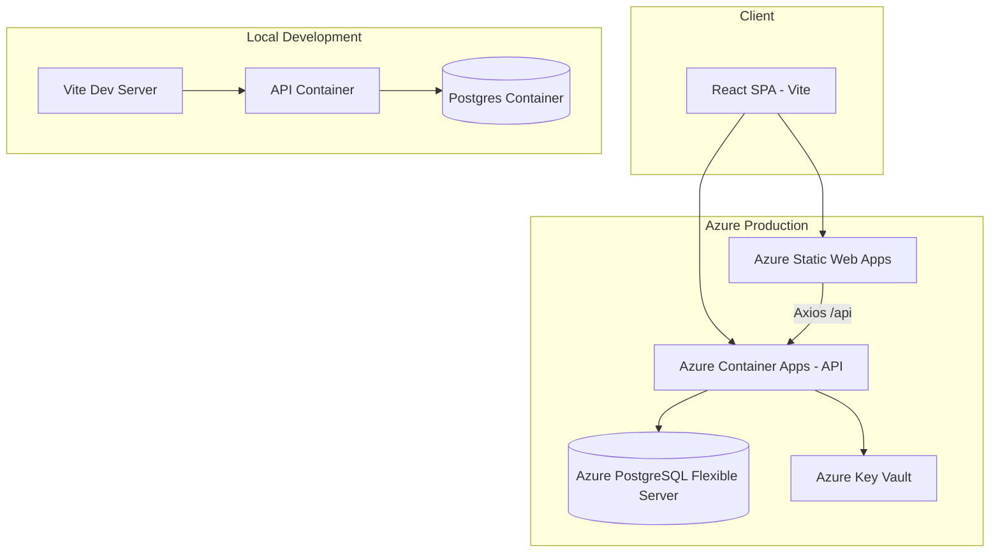
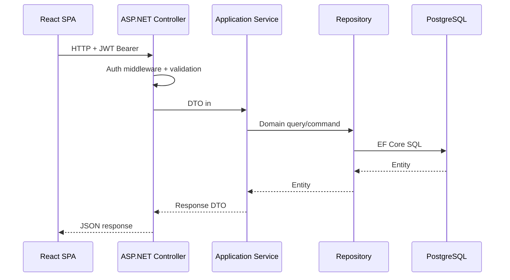
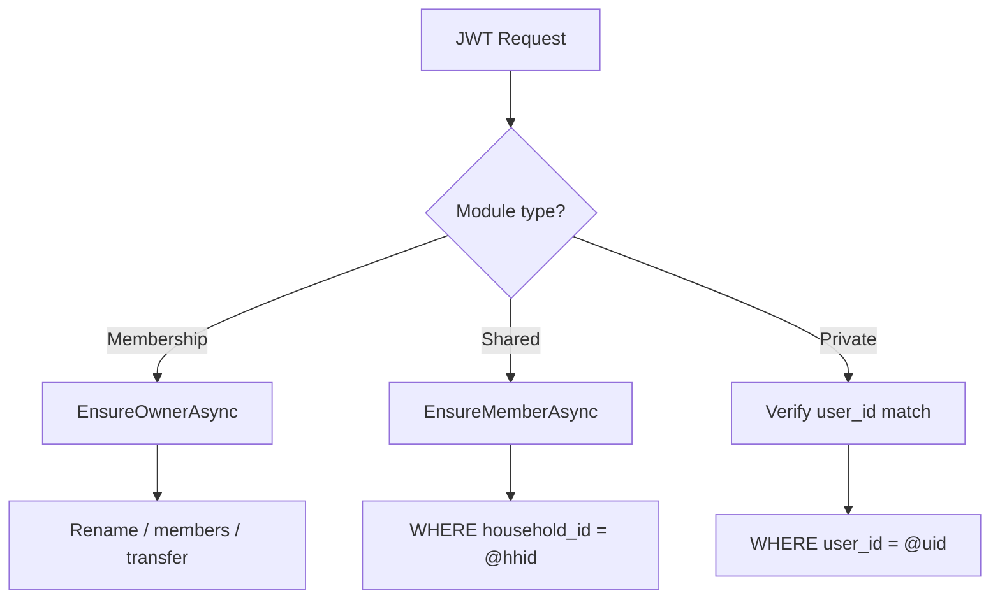
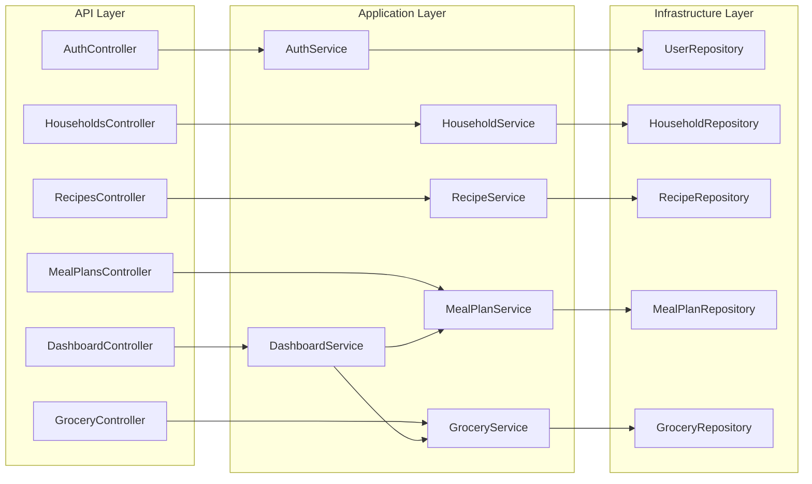
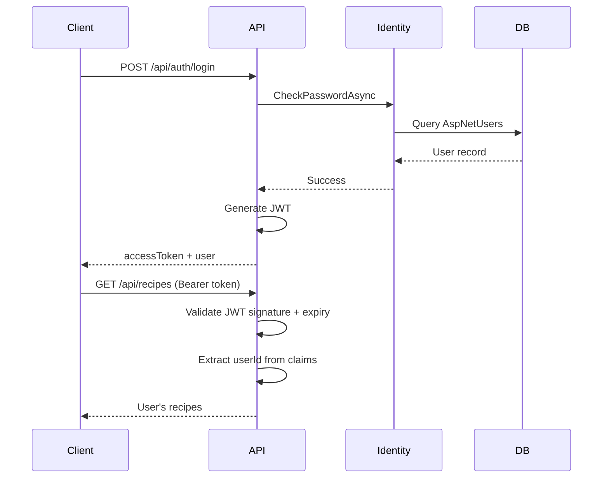
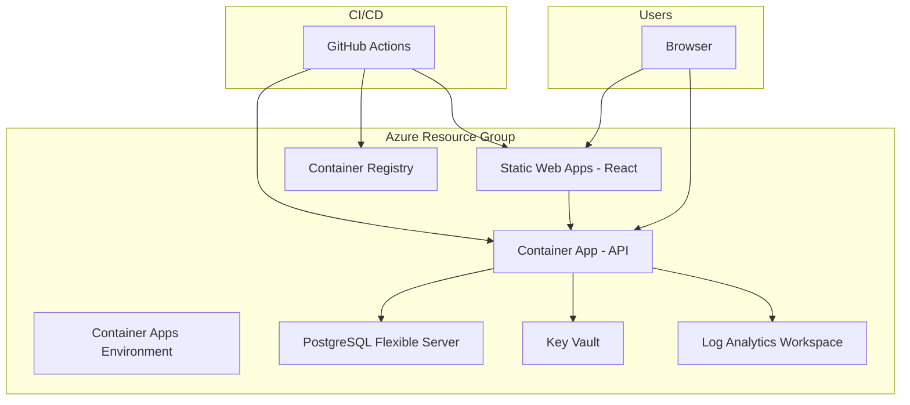
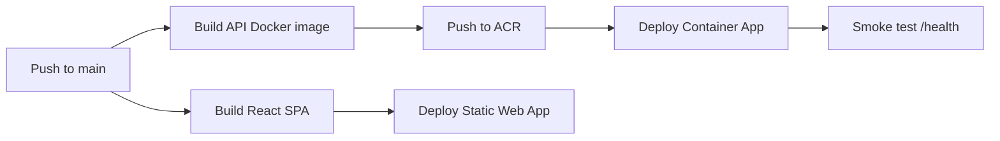

# Smart Meal Planner — System Design

**Version:** 1.2 (MVP)  
**Last Updated:** June 2026  
**Status:** Architecture baseline for implementation

---

## 1. Overview

Smart Meal Planner is a full-stack SaaS application deployed as a **single web app + API** on Microsoft Azure. The backend follows **Clean Architecture** with strict layer separation. The frontend is a React SPA that communicates via REST and JWT.

### Design Principles

- **Simple and debuggable** — monolith API, no microservices, no event buses, no Redis/Kafka in MVP
- **Modular** — each feature module is independently testable and loosely coupled
- **Production-ready** — DTOs, validation, async/await, structured error handling
- **Hybrid data ownership** — household-shared (recipes, meal plan, pantry, grocery, alerts) and user-private (todos, profile prefs)
- **Simple household roles** — Owner (membership management) and Member (shared data access); no complex RBAC
- **Docker-first** — same container images for local dev and Azure deployment

---

## 2. Technology Stack

| Layer | Technology |
|-------|------------|
| API | ASP.NET Core 8 Web API |
| ORM | Entity Framework Core 8 |
| Database | PostgreSQL 16 |
| Auth | ASP.NET Identity + JWT Bearer |
| Frontend | React 18, TypeScript, Vite |
| Styling | Tailwind CSS |
| Data fetching | React Query (TanStack Query) |
| HTTP client | Axios |
| Routing | React Router v6 |
| Validation (API) | FluentValidation |
| Local dev | Docker Compose |
| Cloud | Azure Container Apps, Static Web Apps, PostgreSQL Flexible Server, Key Vault |

---

## 3. High-Level Architecture



### Request Flow



---

## 4. Backend Solution Structure

### 4.1 Solution Layout

```
SmartMealPlanner/
├── SmartMealPlanner.sln
├── src/
│   ├── SmartMealPlanner.Domain/
│   ├── SmartMealPlanner.Application/
│   ├── SmartMealPlanner.Infrastructure/
│   └── SmartMealPlanner.Api/
├── tests/
│   ├── SmartMealPlanner.Application.Tests/
│   └── SmartMealPlanner.Api.Tests/
├── docker/
│   ├── api.Dockerfile
│   └── docker-compose.yml
└── docs/
```

### 4.2 Project Responsibilities

| Project | Responsibility | Dependencies |
|---------|----------------|--------------|
| **Domain** | Entities, enums, domain exceptions, value objects | None |
| **Application** | DTOs, service interfaces, use cases, validators, mapping | Domain |
| **Infrastructure** | EF Core DbContext, repositories, Identity, JWT, migrations | Application, Domain |
| **Api** | Controllers, middleware, DI registration, Swagger | Application, Infrastructure |

**Dependency rule:** Domain ← Application ← Infrastructure ← Api. Domain never references outer layers.

### 4.3 Domain Layer (`SmartMealPlanner.Domain`)

```
SmartMealPlanner.Domain/
├── Common/
│   ├── BaseEntity.cs          # Id, CreatedAt, UpdatedAt
│   ├── AuditableEntity.cs     # CreatedAt, UpdatedAt
│   ├── HouseholdEntity.cs     # + HouseholdId (required), CreatedByUserId
│   └── UserOwnedEntity.cs     # + UserId (required) — for user-private data (todos)
│   └── ISoftDeletable.cs
├── Entities/
│   ├── UserProfile.cs
│   ├── Household.cs
│   ├── HouseholdMember.cs
│   ├── Recipe.cs
│   ├── RecipeIngredient.cs
│   ├── RecipeStep.cs
│   ├── RecipeTag.cs
│   ├── MealPlan.cs
│   ├── MealPlanEntry.cs
│   ├── PantryItem.cs
│   ├── PantryCategory.cs
│   ├── GroceryList.cs
│   ├── GroceryListItem.cs
│   ├── Todo.cs
│   ├── InventoryAlertRule.cs
│   └── InventoryAlertDismissal.cs
├── Enums/
│   ├── MealSlot.cs
│   ├── HouseholdRole.cs     # Owner, Member
│   ├── TodoStatus.cs
│   ├── AlertType.cs
│   └── UnitOfMeasure.cs
└── Exceptions/
    ├── NotFoundException.cs
    ├── ForbiddenException.cs
    └── ValidationException.cs
```

### 4.4 Application Layer (`SmartMealPlanner.Application`)

```
SmartMealPlanner.Application/
├── Common/
│   ├── Interfaces/
│   │   ├── ICurrentUserService.cs
│   │   ├── IHouseholdContext.cs   # HouseholdId, HouseholdRole, IsOwner; EnsureMemberAsync, EnsureOwnerAsync
│   │   └── IDateTimeService.cs
│   ├── Models/
│   │   ├── PaginatedList.cs
│   │   └── ApiResult.cs
│   └── Mappings/
│       └── MappingProfile.cs    # AutoMapper or manual mappers
├── Auth/
│   ├── DTOs/
│   ├── Interfaces/IAuthService.cs
│   ├── Services/AuthService.cs
│   └── Validators/
├── Users/
├── Household/
│   ├── DTOs/
│   ├── Interfaces/IHouseholdService.cs
│   ├── Services/HouseholdService.cs
│   └── Validators/
├── Recipes/
├── MealPlanner/
├── Pantry/
├── Grocery/
├── Todo/
├── InventoryAlerts/
└── Dashboard/
    ├── DTOs/DashboardDto.cs
    ├── Interfaces/IDashboardService.cs
    └── Services/DashboardService.cs
```

Each module folder contains:

- **DTOs** — request/response models for API boundary
- **Interfaces** — service and repository contracts
- **Services** — business logic and orchestration
- **Validators** — FluentValidation rules for request DTOs

### 4.5 Infrastructure Layer (`SmartMealPlanner.Infrastructure`)

```
SmartMealPlanner.Infrastructure/
├── Persistence/
│   ├── ApplicationDbContext.cs
│   ├── Configurations/         # IEntityTypeConfiguration per entity
│   ├── Migrations/
│   └── Repositories/
│       ├── RecipeRepository.cs
│       ├── MealPlanRepository.cs
│       └── ...
├── Identity/
│   ├── ApplicationUser.cs      # Extends IdentityUser<Guid>
│   └── IdentityConfiguration.cs
├── Auth/
│   ├── JwtTokenService.cs
│   └── JwtSettings.cs
└── DependencyInjection.cs
```

### 4.6 API Layer (`SmartMealPlanner.Api`)

```
SmartMealPlanner.Api/
├── Controllers/
│   ├── AuthController.cs
│   ├── UsersController.cs
│   ├── HouseholdsController.cs
│   ├── RecipesController.cs
│   ├── MealPlansController.cs
│   ├── PantryController.cs
│   ├── GroceryController.cs
│   ├── TodosController.cs
│   ├── InventoryAlertsController.cs
│   └── DashboardController.cs
├── Middleware/
│   ├── ExceptionHandlingMiddleware.cs
│   └── RequestLoggingMiddleware.cs
├── Filters/
│   └── ValidateModelFilter.cs
├── Extensions/
│   └── ServiceCollectionExtensions.cs
├── appsettings.json
├── appsettings.Development.json
└── Program.cs
```

**Controller rules:**

- No business logic in controllers
- Accept DTOs, return `ActionResult<T>`
- Delegate to application services only
- Apply `[Authorize]` on protected endpoints

---

## 5. Frontend Structure

```
smart-meal-planner-web/
├── public/
├── src/
│   ├── main.tsx
│   ├── App.tsx
│   ├── pages/
│   │   ├── LoginPage.tsx
│   │   ├── RegisterPage.tsx
│   │   ├── DashboardPage.tsx
│   │   ├── ProfilePage.tsx
│   │   ├── HouseholdPage.tsx
│   │   ├── RecipesPage.tsx
│   │   ├── RecipeDetailPage.tsx
│   │   ├── MealPlannerPage.tsx
│   │   ├── PantryPage.tsx
│   │   ├── GroceryListPage.tsx
│   │   ├── TodosPage.tsx
│   │   └── AlertsPage.tsx
│   ├── features/
│   │   ├── auth/
│   │   ├── profile/
│   │   ├── household/
│   │   ├── recipes/
│   │   ├── meal-planner/
│   │   ├── pantry/
│   │   ├── grocery/
│   │   ├── todos/
│   │   └── inventory-alerts/
│   ├── components/
│   │   ├── layout/
│   │   │   ├── AppLayout.tsx
│   │   │   ├── Navbar.tsx
│   │   │   └── Sidebar.tsx
│   │   ├── ui/
│   │   │   ├── Button.tsx
│   │   │   ├── Input.tsx
│   │   │   ├── Modal.tsx
│   │   │   └── ...
│   │   └── common/
│   │       ├── LoadingSpinner.tsx
│   │       ├── ErrorMessage.tsx
│   │       └── EmptyState.tsx
│   ├── api/
│   │   ├── axiosClient.ts
│   │   ├── authApi.ts
│   │   ├── usersApi.ts
│   │   ├── householdsApi.ts
│   │   ├── recipesApi.ts
│   │   ├── mealPlansApi.ts
│   │   ├── pantryApi.ts
│   │   ├── groceryApi.ts
│   │   ├── todosApi.ts
│   │   ├── inventoryAlertsApi.ts
│   │   └── dashboardApi.ts
│   ├── hooks/
│   │   ├── useAuth.ts
│   │   ├── useRecipes.ts
│   │   ├── useMealPlan.ts
│   │   └── ...
│   ├── types/
│   │   ├── auth.ts
│   │   ├── recipe.ts
│   │   ├── mealPlan.ts
│   │   └── ...
│   ├── contexts/
│   │   └── AuthContext.tsx
│   └── utils/
│       ├── tokenStorage.ts
│       └── dateUtils.ts
├── index.html
├── vite.config.ts
├── tailwind.config.js
├── tsconfig.json
└── package.json
```

### Frontend Patterns

| Concern | Approach |
|---------|----------|
| Server state | React Query (`useQuery`, `useMutation`) |
| Auth token | Axios interceptor attaches JWT from memory/localStorage |
| Protected routes | `ProtectedRoute` wrapper checks auth context |
| Forms | Controlled components + client validation; server errors displayed inline |
| API base URL | `VITE_API_BASE_URL` env variable |

---

## 6. API Architecture

### 6.1 Base URL and Versioning

- Base path: `/api`
- Versioning: implicit v1 (no `/v1` prefix in MVP; add when breaking changes needed)
- Content-Type: `application/json`

### 6.2 Authentication

- Scheme: JWT Bearer (`Authorization: Bearer {token}`)
- Token issued on register/login
- Claims: `sub` (user id), `email`, `role`, `household_id`, `household_role` (`owner` | `member`), `jti`, `exp`
- Refresh token: optional in MVP; document endpoint for future (`POST /api/auth/refresh`)

### 6.3 Endpoint Summary

| Module | Method | Endpoint | Auth |
|--------|--------|----------|------|
| Auth | POST | `/api/auth/register` | No |
| Auth | POST | `/api/auth/login` | No |
| Auth | POST | `/api/auth/logout` | Yes |
| Users | GET | `/api/users/me` | Yes |
| Users | PUT | `/api/users/me` | Yes |
| Household | GET | `/api/households/me` | Yes (member+) |
| Household | PUT | `/api/households/me` | Yes (owner) |
| Household | POST | `/api/households/me/members` | Yes (owner) |
| Household | DELETE | `/api/households/me/members/{userId}` | Yes (owner) |
| Household | POST | `/api/households/me/transfer-ownership` | Yes (owner) |
| Recipes | GET/POST | `/api/recipes` | Yes |
| Recipes | GET/PUT/DELETE | `/api/recipes/{id}` | Yes |
| Meal Plans | GET | `/api/meal-plans?weekStart={date}` | Yes |
| Meal Plans | POST | `/api/meal-plans/{planId}/entries` | Yes |
| Meal Plans | PUT/DELETE | `/api/meal-plans/entries/{entryId}` | Yes |
| Pantry | GET/POST | `/api/pantry/items` | Yes |
| Pantry | PUT/DELETE | `/api/pantry/items/{id}` | Yes |
| Pantry | GET | `/api/pantry/categories` | Yes |
| Grocery | GET/POST | `/api/grocery/lists` | Yes |
| Grocery | GET | `/api/grocery/lists/{id}` | Yes |
| Grocery | POST | `/api/grocery/lists/{id}/items` | Yes |
| Grocery | PUT/DELETE | `/api/grocery/lists/items/{itemId}` | Yes |
| Grocery | POST | `/api/grocery/lists/generate-from-meal-plan` | Yes |
| Todos | GET/POST | `/api/todos` | Yes |
| Todos | PUT/DELETE | `/api/todos/{id}` | Yes |
| Todos | PATCH | `/api/todos/{id}/complete` | Yes |
| Alerts | GET | `/api/inventory-alerts` | Yes |
| Alerts | PATCH | `/api/inventory-alerts/{id}/dismiss` | Yes |
| Dashboard | GET | `/api/dashboard` | Yes |

### 6.4 Standard Response Shapes

**Success (single resource):**

```json
{
  "data": { },
  "success": true
}
```

**Success (paginated list):**

```json
{
  "data": [],
  "page": 1,
  "pageSize": 20,
  "totalCount": 100,
  "success": true
}
```

**Error (Problem Details — RFC 7807):**

```json
{
  "type": "https://tools.ietf.org/html/rfc7231#section-6.5.1",
  "title": "Validation Error",
  "status": 400,
  "detail": "One or more validation errors occurred.",
  "errors": {
    "Email": ["Email is required."]
  }
}
```

### 6.5 HTTP Status Codes

| Code | Usage |
|------|-------|
| 200 | Success (GET, PUT, PATCH) |
| 201 | Created (POST) |
| 204 | No content (DELETE) |
| 400 | Validation error |
| 401 | Missing or invalid JWT |
| 403 | Authenticated but not authorized (wrong owner) |
| 404 | Resource not found |
| 409 | Conflict (duplicate email, duplicate week plan) |
| 500 | Unhandled server error (logged, generic message to client) |

### 6.6 Authorization Pattern

The API uses **three authorization scopes** depending on the module:

#### Household membership operations (rename, add/remove members, transfer ownership)

1. Resolve `currentUserId`, `householdId`, and `householdRole` from JWT / `IHouseholdContext`
2. Call `await householdContext.EnsureOwnerAsync(householdId)` — throws `ForbiddenException` if not Owner
3. Mutations run in a transaction when changing roles (transfer ownership)

```csharp
public interface IHouseholdContext
{
    Guid UserId { get; }
    Guid HouseholdId { get; }
    HouseholdRole Role { get; }  // Owner | Member
    bool IsOwner { get; }
    Task EnsureMemberAsync(CancellationToken ct = default);
    Task EnsureOwnerAsync(CancellationToken ct = default);
}
```

#### Household-shared resources (Recipes, Meal Plans, Pantry, Grocery, Inventory Alerts)

1. Resolve `currentUserId` and `householdId` from JWT / `IHouseholdContext`
2. Call `await householdContext.EnsureMemberAsync()` — verifies `household_members` row exists
3. Filter queries by `household_id = @householdId`
4. On create, set `household_id` from context and `created_by_user_id` from current user
5. On update/delete, verify `entity.HouseholdId == householdId` or throw `ForbiddenException`
6. Any household member (Owner or Member) may edit shared resources — no per-resource ACL

#### User-private resources (Todos, Profile preferences)

1. Resolve `currentUserId` from `ICurrentUserService`
2. Filter queries by `user_id = @currentUserId`
3. On update/delete, verify `entity.UserId == currentUserId` or throw `ForbiddenException`
4. No `household_id` on todos — household members cannot see each other's tasks

#### Dashboard aggregation

- Meal plan, pantry, alerts: household scope
- Todos: user scope only



---

## 7. Module Interaction Diagram



---

## 8. Security Architecture

### 8.1 Authentication Flow



### 8.2 Security Controls

| Control | Implementation |
|---------|----------------|
| Password storage | ASP.NET Identity PBKDF2 hasher |
| Transport | HTTPS only in production (TLS termination at Azure ingress) |
| CORS | Allow frontend origin only (SWA URL + localhost in dev) |
| JWT secret | Stored in Azure Key Vault; never in source control |
| SQL injection | EF Core parameterized queries |
| Input validation | FluentValidation + model binding |
| Rate limiting | Optional middleware in future; not MVP |
| RBAC | Platform `User`/`Admin` roles in JWT; household `owner`/`member` via `household_role` claim |

---

## 9. Database Access Pattern

- **Code-First** EF Core migrations
- **Repository pattern** per aggregate (Recipe, MealPlan, Pantry, etc.)
- **Unit of Work** via `ApplicationDbContext.SaveChangesAsync()`
- **No raw SQL** in MVP unless performance requires it (document if added)
- **Transactions** for multi-entity operations (e.g., create recipe with ingredients + steps)

### Connection String

- Local: `docker-compose.yml` environment variable
- Azure: Key Vault reference in Container Apps config
- Pooling: enabled via Npgsql default connection pooling

---

## 10. Deployment Architecture

### 10.1 Azure Production Topology



### 10.2 Azure Services

| Service | SKU (MVP) | Purpose |
|---------|-----------|---------|
| Azure Container Apps | Consumption | Host ASP.NET API Docker image |
| Azure Static Web Apps | Free/Standard | Host Vite-built React SPA |
| Azure Database for PostgreSQL | Burstable B1ms (dev/staging) | Managed PostgreSQL |
| Azure Key Vault | Standard | Secrets (JWT key, connection string) |
| Azure Container Registry | Basic | Store API Docker images |
| Log Analytics | Pay-as-you-go | Container Apps logs and metrics |

**Not used in MVP:** AKS, Redis, Service Bus, Application Gateway (Container Apps ingress is sufficient).

### 10.3 Environment Strategy

| Environment | Purpose | Infrastructure |
|-------------|---------|----------------|
| **local** | Developer machines | Docker Compose (api + web + postgres) |
| **staging** | Pre-production testing | Azure (smaller SKUs) |
| **production** | Live users | Azure (scaled SKUs) |

### 10.4 Docker Compose (Local)

```yaml
# Conceptual — implemented in Step 2 scaffolding
services:
  postgres:
    image: postgres:16
    ports: ["5432:5432"]
  api:
    build: ./docker/api.Dockerfile
    ports: ["5000:8080"]
    depends_on: [postgres]
  web:
    build: ./docker/web.Dockerfile
    ports: ["5173:80"]
    depends_on: [api]
```

### 10.5 CI/CD Pipeline (GitHub Actions)



**Pipeline stages:**

1. **Build & Test** — `dotnet test`, `npm test` (when tests exist)
2. **Build images** — API Dockerfile → ACR
3. **Build frontend** — `npm run build` → SWA artifact
4. **Deploy** — `az containerapp update`, SWA deploy action
5. **Migrate** — `dotnet ef database update` (staging/prod job with Key Vault secrets)

### 10.6 Health Checks

- `GET /health` — API liveness (returns 200)
- `GET /health/ready` — includes DB connectivity check

### 10.7 Future Migration Path to AKS

When traffic or complexity grows:

1. Move API container image from Container Apps to AKS deployment (same image, same ACR)
2. Add ingress controller (nginx or AGIC)
3. Consider read replicas on PostgreSQL
4. Introduce Redis for distributed caching if needed

Container Apps knowledge maps to AKS: revisions ≈ deployments, ingress ≈ Kubernetes ingress, secrets ≈ K8s secrets (Key Vault CSI driver).

---

## 11. Observability

| Concern | MVP Approach |
|---------|--------------|
| Logging | ASP.NET built-in logging → Log Analytics |
| Errors | Exception middleware logs full stack; client sees safe message |
| Metrics | Container Apps built-in metrics (CPU, memory, requests) |
| Tracing | Deferred; add OpenTelemetry post-MVP |
| Alerts | Azure Monitor alert on API 5xx rate (manual setup) |

---

## 12. Testing Strategy

| Layer | Type | Tools |
|-------|------|-------|
| Application | Unit tests | xUnit, Moq, FluentAssertions |
| API | Integration tests | WebApplicationFactory, Testcontainers (PostgreSQL) |
| Frontend | Component tests | Vitest, React Testing Library (post-scaffold) |
| E2E | Manual MVP; automate later | Playwright (future) |

Each module should have service-level tests before frontend integration.

---

## 13. Configuration Management

| Setting | Local | Azure |
|---------|-------|-------|
| Connection string | `appsettings.Development.json` | Key Vault reference |
| JWT secret | User secrets / env var | Key Vault |
| CORS origins | `http://localhost:5173` | SWA production URL |
| Log level | Debug | Information |

Never commit secrets. Use `.env.example` for local documentation only.

---

## 14. Scalability Notes (MVP)

- Container Apps auto-scales on HTTP requests (min 0 or 1 replica)
- PostgreSQL Burstable tier sufficient for hundreds of concurrent users
- Stateless API — horizontal scaling ready
- No caching layer in MVP; add Redis when dashboard/recipe list latency requires it

---

## 15. Document History

| Version | Date | Changes |
|---------|------|---------|
| 1.0 | June 2026 | Initial system design for MVP |
| 1.1 | June 2026 | Hybrid ownership: household-shared vs user-private authorization |
| 1.2 | June 2026 | HouseholdRole enum; IHouseholdContext Owner/Member guards; Household module; JWT household_role claim |
